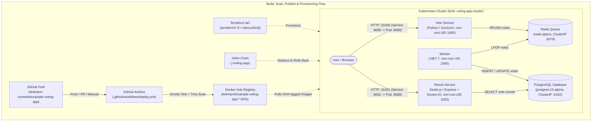

# DevOps Capstone 1: Example Voting App

Forked from [`dockersamples/example-voting-app`](https://github.com/dockersamples/example-voting-app) and implemented as a reproducible, hardened, CI/CD-automated Kubernetes deployment for **DevOps Capstone 1: Ship It**.

- **Fork Repository:** `https://github.com/dotmann-commits/example-voting-app`
- **Published Docker Hub Images (Commit SHA `21d83786f7f7b89081885305be0ea1dd0245b777`):**
  - `dotmann/example-voting-app-vote:21d83786f7f7b89081885305be0ea1dd0245b777`
  - `dotmann/example-voting-app-result:21d83786f7f7b89081885305be0ea1dd0245b777`
  - `dotmann/example-voting-app-worker:21d83786f7f7b89081885305be0ea1dd0245b777`

---

## 1. Project Purpose & Architecture

The Voting App is a five-component distributed system that accepts user votes, queues them in memory, processes them asynchronously into a relational database, and displays live totals.


### Runtime Data Flow & CI/CD Provisioning Diagram



### Service Responsibilities & Vote Data Flow

| Service | Runtime / Image | Role in Vote Flow | Network Exposure |
| :--- | :--- | :--- | :--- |
| **`vote`** | Python 3.11 / Flask / Gunicorn (`dotmann/example-voting-app-vote`) | Front-end web UI where a user submits option `a` (Cats) or `b` (Dogs) and pushes the event to Redis. | User-facing (`8080:80` in Compose; `NodePort 31000` -> Service `8080` -> Pod `8080` in Kubernetes) |
| **`redis`** | `redis:alpine` | In-memory queue holding incoming votes until processed by the worker. | Internal only (`ClusterIP 6379`) |
| **`worker`** | .NET 7 (`dotmann/example-voting-app-worker`) | Background consumer that pops votes from Redis and writes them to PostgreSQL (`votes` table). | Internal only (Deployment, no Service) |
| **`db`** | `postgres:15-alpine` | Relational database storing vote records (`id`, `vote`). Uses a persistent named volume (`db-data`) in Docker Compose, and ephemeral `emptyDir` storage in Kubernetes (`k8s-specifications` parity; data is lost if the `db` Pod is replaced). | Internal only (`ClusterIP 5432`) |
| **`result`** | Node.js 18 / Express / Socket.IO (`dotmann/example-voting-app-result`) | Web UI that queries PostgreSQL every second and streams live vote totals to browsers. | User-facing (`8081:80` in Compose; `NodePort 31001` -> Service `8081` -> Pod `8080` in Kubernetes) |

---

## 2. Repository Structure

```text
example-voting-app/
|-- .github/
|   |-- workflows/
|       |-- deploy.yml                        # Stage 4 CI: Compose test, Trivy scans, Docker Hub SHA publish
|       |-- call-docker-build-vote.yaml       # Upstream workflow (preserved, trigger set to workflow_dispatch)
|       |-- call-docker-build-result.yaml     # Upstream workflow (preserved, trigger set to workflow_dispatch)
|       |-- call-docker-build-worker.yaml     # Upstream workflow (preserved, trigger set to workflow_dispatch)
|-- terraform/
|   |-- .gitignore                            # Excludes .terraform/, *.tfstate*, *.tfvars, kubeconfig*
|   |-- .terraform.lock.hcl                   # Provider lockfile (tehcyx/kind v0.6.0)
|   |-- main.tf                               # kind_cluster resource (control-plane + worker, NodePorts 31000/31001)
|   |-- outputs.tf                            # Non-sensitive cluster outputs
|   |-- variables.tf                          # Cluster name, node image, and kubeconfig path variables
|   |-- versions.tf                           # Terraform and provider version constraints
|-- voting-app/
|   |-- .helmignore
|   |-- Chart.yaml                            # Stage 5 Helm chart metadata
|   |-- values.yaml                           # Image repositories, commit SHA tag, service & port settings
|   |-- templates/                            # Deployments and Services for vote, result, worker, redis, db
|-- vote/                                     # Python Vote service + hardened Dockerfile & .dockerignore
|-- result/                                   # Node.js Result service + hardened Dockerfile & .dockerignore
|-- worker/                                   # .NET Worker service + hardened Dockerfile & .dockerignore
|-- healthchecks/                             # Compose healthcheck scripts for Redis and PostgreSQL
|-- k8s-specifications/                       # Original upstream reference Kubernetes manifests
|-- seed-data/                                # Upstream vote seed utility
|-- docker-compose.yml                        # Local Docker Compose specification
|-- docker-compose.images.yml                 # Upstream prebuilt-image Compose file
|-- docker-stack.yml                          # Upstream Docker Swarm stack specification
|-- .dockerignore                             # Root build context exclusions
|-- README.md
```

---

## 3. Prerequisites

Verified in Ubuntu 26.04.1 LTS on WSL 2:
- **Git** (`git version 2.53.0`)
- **Docker Engine & Docker Compose Plugin** (`Docker version 29.9.2, build a82e528`, `Docker Compose version v5.6.1`)
- **Terraform CLI** (`Terraform v1.9.8`)
- **kind** (`v0.24.0`)
- **kubectl** (`Client Version: v1.37.1`)
- **Helm** (`v3.22.1`)

---

## 4. Stage 1: Run and Test Locally with Docker Compose

### Commands to Run (Reviewer Instructions)

```bash
cd ~/projects/example-voting-app
docker compose up -d
docker compose ps
```

- **Vote UI:** `http://localhost:8080`
- **Result UI:** `http://localhost:8081`

*(Note: While the general capstone brief mentions ports `5000`/`5001`, this repository's `docker-compose.yml` maps host port `8080:80` for `vote` and `8081:80` for `result`).*

Test voting and inspect logs:

```bash
curl -fsS -X POST -d "vote=a" http://localhost:8080 >/dev/null
curl -fsS -X POST -d "vote=b" http://localhost:8080 >/dev/null
docker compose logs --tail=30 worker
```

Stop the local stack while preserving the `example-voting-app_db-data` volume (do **not** pass `-v`):

```bash
docker compose down
```

### Verified Stage 1 Output
```text
worker-1  | Connected to db
worker-1  | Connecting to redis
worker-1  | Found redis at 172.19.0.3
worker-1  | Processing vote for 'a' by '59a393808b51a67'
worker-1  | Processing vote for 'b' by 'cdde808132ae285'
```

---

## 5. Stage 2: Container Security Hardening & Rationale

### Changes Implemented
1. **Clean Build Contexts (`.dockerignore`):**
   - Added root `.dockerignore` and service-specific `vote/.dockerignore`, `result/.dockerignore`, and `worker/.dockerignore` excluding `.git`, `.gitignore`, `**/__pycache__`, `**/node_modules`, `bin/`, `obj/`, `.env*`, and `*.log` to prevent local metadata or secrets from entering image build contexts.
2. **Pinned Base Image Tags:**
   - `vote/Dockerfile`: `python:3.11-slim` -> `python:3.11.11-slim-bookworm`
   - `result/Dockerfile`: `node:18-slim` -> `node:18.20.8-bookworm-slim`
   - `worker/Dockerfile`: `mcr.microsoft.com/dotnet/sdk:7.0` -> `mcr.microsoft.com/dotnet/sdk:7.0.410-bookworm-slim` and `mcr.microsoft.com/dotnet/runtime:7.0` -> `mcr.microsoft.com/dotnet/runtime:7.0.20-bookworm-slim`
3. **Non-Root Runtime Execution (`USER`) & `HEALTHCHECK`:**
   - `vote/Dockerfile`: Created unprivileged user `appuser` (`UID 1000`), chowned `/usr/local/app`, added `HEALTHCHECK`, and set `USER appuser` in both `dev` and `final` stages.
   - `result/Dockerfile`: Set ownership of `/usr/local/app` and `/node_modules` to the built-in `node` user (`UID 1000`), added `HEALTHCHECK`, and set `USER node`.
   - `worker/Dockerfile`: Created unprivileged user `appuser` (`UID 1000`), copied `/app` with `--chown=appuser:appuser`, added `HEALTHCHECK`, and set `USER appuser`.

### Verified Stage 2 Output (`docker compose exec -T <service> id`)
```text
vote:   uid=1000(appuser) gid=1000(appuser) groups=1000(appuser)
result: uid=1000(node) gid=1000(node) groups=1000(node)
worker: uid=1000(appuser) gid=1000(appuser) groups=1000(appuser)
```

---

## 6. Stage 3: Reproducible Kubernetes Cluster with Terraform

> **Cost & Architecture Note:** To guarantee zero cloud spend (`$0.00`) while satisfying the Terraform Infrastructure-as-Code lifecycle (`fmt`, `init`, `validate`, `plan`, `apply`, `destroy`), `terraform/` provisions a local 2-node Kubernetes `v1.31.0` cluster (`voting-app-cluster`) on Docker using the `tehcyx/kind` provider (`~> 0.6.0`). Cloud-specific AWS EKS/VPC resources are intentionally not used so no billable cloud resources are created. If a reviewer runs this in another environment, override `kubeconfig_path` (e.g., `-var="kubeconfig_path=$HOME/.kube/config"`), as `variables.tf` defaults to `/home/btee2/.kube/config`.

### Commands to Provision and Verify (Reviewer Instructions)

```bash
cd ~/projects/example-voting-app/terraform
terraform fmt -check
terraform init
terraform validate
terraform plan
terraform apply -var="kubeconfig_path=$HOME/.kube/config"
```

Verify cluster readiness:

```bash
kubectl get nodes -o wide
kubectl get namespaces
kubectl cluster-info
```

### Verified Stage 3 Output (Destroy & Recreate from Code)

```text
kind_cluster.voting_app: Destroying... [id=voting-app-cluster-kindest/node:v1.31.0]
kind_cluster.voting_app: Destruction complete after 2s
Destroy complete! Resources: 1 destroyed.

kind_cluster.voting_app: Creating...
kind_cluster.voting_app: Creation complete after 42s [id=voting-app-cluster-kindest/node:v1.31.0]
Apply complete! Resources: 1 added, 0 changed, 0 destroyed.

Outputs:
cluster_name = "voting-app-cluster"
endpoint = "https://127.0.0.1:40087"
kubeconfig_path = "/home/btee2/.kube/config"

NAME                               STATUS   ROLES           AGE   VERSION   INTERNAL-IP   OS-IMAGE
voting-app-cluster-control-plane   Ready    control-plane   29s   v1.31.0   172.19.0.2    Debian GNU/Linux 12 (bookworm)
voting-app-cluster-worker          Ready    <none>          15s   v1.31.0   172.19.0.3    Debian GNU/Linux 12 (bookworm)
```

### Cleanup Instructions (Reviewer Instructions)

```bash
cd ~/projects/example-voting-app/terraform
terraform plan -destroy
terraform destroy
```

---

## 7. Stage 4: CI/CD Pipeline with GitHub Actions, Trivy, and Docker Hub

### Workflow Overview (`.github/workflows/deploy.yml`)
Triggered on `push` to `main`, `pull_request` to `main`, and `workflow_dispatch` with least-privilege `permissions: contents: read`:
1. **Compose Validation & Build:** Runs `docker compose config -q` and builds production images (`vote` targeting `final`, `result`, and `worker`) tagged with `${{ github.sha }}`.
2. **Non-Root Verification & Integration Smoke Test:** Verifies container UIDs (`!= 0`), starts an isolated Compose project (`ci-test-${{ github.run_id }}`), exits non-zero if `:8080` or `:8081` fails readiness within 30 retries, submits a test vote (`vote=a`), verifies `worker` logs `"Processing vote"`, and cleans up via `docker compose -p ci-test-${{ github.run_id }} down --remove-orphans` (without `-v`).
3. **Trivy Security Scans (`aquasecurity/trivy-action@v0.36.0`):**
   - **Blocking Secret Scan (`exit-code: '1'`):** Scans the repository (`scan-type: 'fs'`, `scanners: 'secret'`, `severity: 'CRITICAL,HIGH'`) and fails if any exposed secret is found.
   - **Blocking Misconfiguration Scan (`exit-code: '1'`):** Scans application Dockerfiles and Terraform IaC (`scan-type: 'config'`, `skip-dirs: 'k8s-specifications,result/tests,seed-data'`, `severity: 'CRITICAL,HIGH'`).
   - **Non-Blocking Vulnerability Audit (`exit-code: '0'`):** Audits repository dependencies (`fs`) and all three built container images (`vote`, `result`, `worker`) for `CRITICAL,HIGH` CVEs and prints full table reports in the Actions logs.
4. **Docker Hub Publishing (`if: github.event_name == 'push' && github.ref == 'refs/heads/main'`):** Logs in to Docker Hub and pushes all three images tagged with the full commit SHA (`${{ github.sha }}`). Pull requests never publish images.

### Required GitHub Actions Repository Secrets (Names Only)
Configure under **Settings -> Secrets and variables -> Actions**:
- `DOCKERHUB_USERNAME` - Plain Docker Hub username ID (e.g., `dotmann`)
- `DOCKERHUB_TOKEN` - Docker Hub Personal Access Token (`Read & Write`)

### Verified Stage 4 Output
- **GitHub Actions Run:** Run ID `40471014013` (Job `122148174341` on commit `21d83786f7f7b89081885305be0ea1dd0245b777`) completed with **`SUCCESS` (`2m52s`)**.
- **Published Docker Hub Images Verified via `docker manifest inspect`:**
  - `dotmann/example-voting-app-vote:21d83786f7f7b89081885305be0ea1dd0245b777` (`sha256:249a351068ebffc8ace408138cd35a2362fc300a41b8f69c6d369fd76237a094`)
  - `dotmann/example-voting-app-result:21d83786f7f7b89081885305be0ea1dd0245b777` (`sha256:f371d1fdb4cb0f21d99282b9bf6235c2cb80d71c0f12e6153a13e23cfad68637`)
  - `dotmann/example-voting-app-worker:21d83786f7f7b89081885305be0ea1dd0245b777` (`sha256:75c954f1252903ad80a020d671380006cf0c853e4ed4d7d21873a16fd67f907f`)

---

## 8. Stage 5: Deploy and Roll Back with Helm

### Port & Non-Root Compatibility Design
In Kubernetes pods, unprivileged users (`UID 1000`) cannot bind to privileged ports `< 1024` (`port 80`) by default (`EACCES` / `Permission denied`). To preserve non-root execution without elevated kernel capabilities or image rebuilds, the `./voting-app` Helm chart configures `vote` (`gunicorn ... -b 0.0.0.0:8080`) and `result` (`PORT="8080"`) to listen on container port `8080` (`targetPort: 8080`), while preserving the upstream Kubernetes Service ports (`8080` and `8081`) and NodePorts (`31000` and `31001`). Unlike Docker Compose (which persists PostgreSQL data in the named `db-data` volume across `docker compose down`), the Kubernetes `db` and `redis` deployments use ephemeral `emptyDir` volumes matching `k8s-specifications/`, meaning database records persist across container restarts within the same Pod but are lost if the `db` Pod is deleted or replaced.

### Commands to Validate, Deploy, and Test (Reviewer Instructions)

```bash
cd ~/projects/example-voting-app
helm lint ./voting-app
helm template my-vote-release ./voting-app
helm install my-vote-release ./voting-app
helm status my-vote-release
kubectl get deployments
kubectl get pods -o wide
kubectl get services
```

Access the deployed application:
- **Vote UI (NodePort):** `http://localhost:31000` (or via port-forward: `kubectl port-forward service/vote 5000:8080` -> `http://localhost:5000`)
- **Result UI (NodePort):** `http://localhost:31001` (or via port-forward: `kubectl port-forward service/result 5001:8081` -> `http://localhost:5001`)

### Commands to Demonstrate Failure & Live Rollback (Reviewer Instructions)

```bash
# 1. Inspect release history and note the current known-good revision number
helm history my-vote-release

# 2. Upgrade with a deliberate nonexistent Vote image tag
helm upgrade my-vote-release ./voting-app --set vote.image.tag=nonexistent-tag-rollback-demo
kubectl get pods

# 3. Roll back to the known-good revision (replace <KNOWN_GOOD_REVISION> with the revision from step 1;
#    on a fresh install this is 1, or 2 in our verified session below)
helm rollback my-vote-release <KNOWN_GOOD_REVISION>
helm status my-vote-release
helm history my-vote-release
kubectl get pods
```

### Verified Stage 5 Deployment & Rollback Evidence

*(Note: In our live session, Revision `1` was the initial install before the unprivileged port `8080` template update, and Revision `2` was the healthy `helm upgrade` with the port `8080` fix. Therefore, Revision `2` was the known-good revision rolled back to after the deliberate broken upgrade in Revision `3`).*

1. **Failed Upgrade (Revision `3`) Captured (`kubectl get pods -o wide` & `kubectl describe pod`):**
   ```text
   NAME                      READY   STATUS         RESTARTS   AGE     IP           NODE
   db-5b8f566868-gthd2       1/1     Running        0          14m     10.244.1.3   voting-app-cluster-worker
   redis-5b65678587-g4ndj    1/1     Running        0          14m     10.244.1.6   voting-app-cluster-worker
   result-c9bc868d8-ltl8j    1/1     Running        0          2m49s   10.244.1.7   voting-app-cluster-worker
   vote-597789594b-ldqjv     1/1     Running        0          2m49s   10.244.1.8   voting-app-cluster-worker
   vote-7dc8fbd679-wk7cr     0/1     ErrImagePull   0          9s      10.244.1.9   voting-app-cluster-worker
   worker-7cf695c5b8-krd89   1/1     Running        0          14m     10.244.1.4   voting-app-cluster-worker
   ```
   `kubectl describe pod vote-7dc8fbd679-wk7cr`:
   `Failed to pull image "dotmann/example-voting-app-vote:nonexistent-tag-rollback-demo": rpc error: code = NotFound ... Error: ErrImagePull / ImagePullBackOff`

2. **Successful Rollback to Known-Good Revision `2` (`helm history my-vote-release`):**
   ```text
   REVISION  UPDATED                   STATUS      CHART             APP VERSION                               DESCRIPTION
   1         Tue Oct 27 11:04:07 2026  superseded  voting-app-0.1.0  21d83786f7f7b89081885305be0ea1dd0245b777  Install complete
   2         Tue Oct 27 11:16:15 2026  superseded  voting-app-0.1.0  21d83786f7f7b89081885305be0ea1dd0245b777  Upgrade complete
   3         Tue Oct 27 11:18:55 2026  superseded  voting-app-0.1.0  21d83786f7f7b89081885305be0ea1dd0245b777  Upgrade complete
   4         Tue Oct 27 11:19:04 2026  deployed    voting-app-0.1.0  21d83786f7f7b89081885305be0ea1dd0245b777  Rollback to 2
   ```

3. **Post-Rollback Pod Recovery & Database Vote Verification:**
   ```text
   NAME                      READY   STATUS    RESTARTS   AGE     IP           NODE
   db-5b8f566868-gthd2       1/1     Running   0          15m     10.244.1.3   voting-app-cluster-worker
   redis-5b65678587-g4ndj    1/1     Running   0          15m     10.244.1.6   voting-app-cluster-worker
   result-c9bc868d8-ltl8j    1/1     Running   0          2m54s   10.244.1.7   voting-app-cluster-worker
   vote-597789594b-ldqjv     1/1     Running   0          2m54s   10.244.1.8   voting-app-cluster-worker
   worker-7cf695c5b8-krd89   1/1     Running   0          15m     10.244.1.4   voting-app-cluster-worker

          id        | vote
   -----------------+------
    5b61a0ca0bf9a85 | a
    5b9bebda3dd0ad2 | b
    e62c3aeb8fcb19f | a
   (3 rows)

    vote | count
   ------+-------
    a    |     2
    b    |     1
   (2 rows)
   ```
